<div align="center">


<a href="#-how-it-works">
  
</a>

<p>
  
  
  
  
  <br>
  
  
  
  
  
</p>

**[Demo](#-see-it-in-action) · [How it works](#-how-it-works) · [Features](#-features) · [Quick start](#-quick-start) · [AI model](#-the-ai-model) · [API](#-api-reference) · [Roadmap](#-roadmap)**

</div>

---

## 💡 Why AccidentAlert AI?

After a serious road crash, **every minute without help matters**. The first hour, often called the *golden hour*, is when treatment makes the biggest difference. Yet many crashes are reported late: the driver may be unconscious, alone, or on a quiet road at night.

**AccidentAlert AI** closes that gap. A small sensor in the vehicle feels the impact, the driver's phone gives them a few seconds to say *"I'm OK"*, and if they don't, responders get the crash location, severity and impact force **automatically**. A shared portal then lets emergency stations coordinate who responds, track progress and learn where crashes happen.

<br>

## 🎬 See it in action

<table>
  <tr>
    <th width="28%">📱 Driver's phone</th>
    <th>🖥️ Responder portal</th>
  </tr>
  <tr>
    <td align="center" valign="top">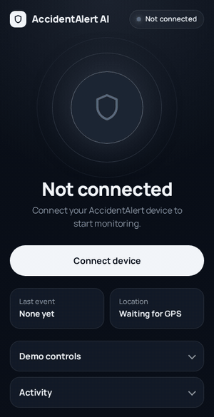</td>
    <td align="center" valign="top">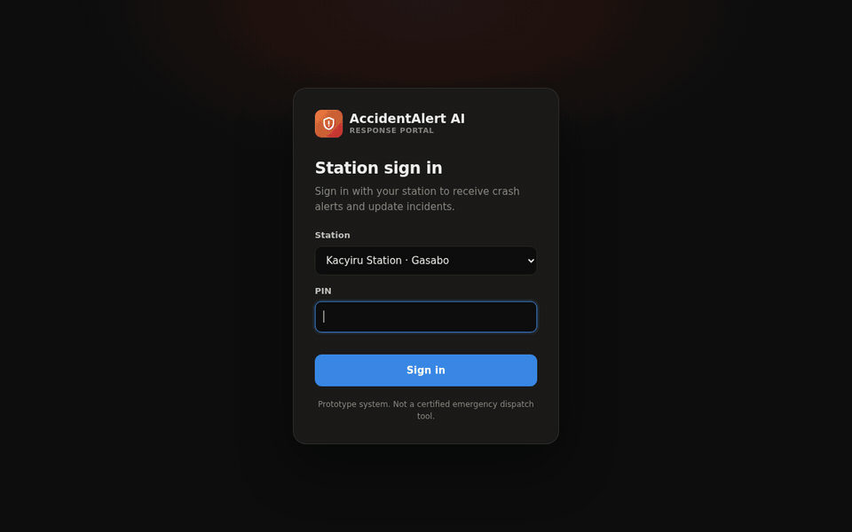</td>
  </tr>
  <tr>
    <td><sub>Crash detected → cancel countdown → alert sent with GPS.</sub></td>
    <td><sub>Alarm on every station → acknowledge → en route → on scene → resolved → analytics.</sub></td>
  </tr>
</table>

<br>

## ⚙️ How it works

<p align="center"></p>

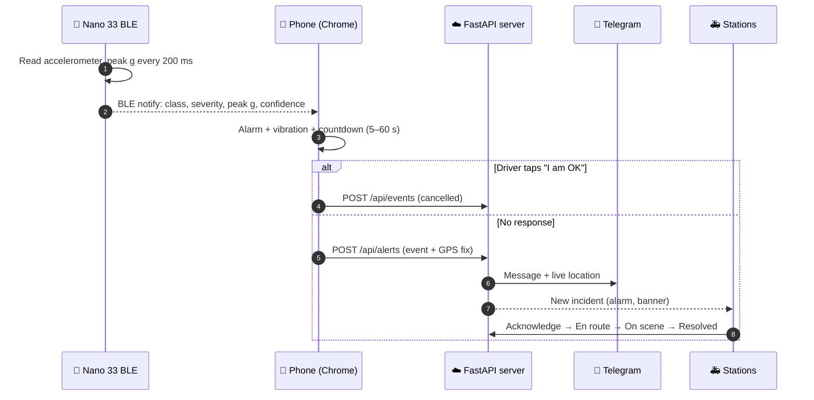

<br>

## ✨ Features

<table>
<tr>
<td width="50%" valign="top">

### 🚗 In the vehicle
- **Impact detection** on an Arduino Nano 33 BLE (up to ±16 g on Rev1)
- **Severity levels** from peak force: minor, serious, critical
- **Saturation flag** when the impact exceeds the sensor range
- **Heartbeat** every second, so the phone knows the sensor is alive
- **Edge AI firmware**: a small neural network that runs on the board itself

</td>
<td width="50%" valign="top">

### 📱 On the phone
- Connects over **Web Bluetooth**, so there's no app to install
- **Cancel window** with countdown, alarm sound and vibration
- **High-accuracy GPS** attached to every alert
- **Retries** sending up to 6 times on a bad network
- Screen **wake lock** and automatic reconnects

</td>
</tr>
<tr>
<td valign="top">

### 🚑 Responder portal
- **Station sign-in** with a PIN
- **Live incident queue**: critical and unassigned incidents first
- **Status workflow**: Unassigned → Acknowledged → En route → On scene → Resolved / False alarm
- **One station leads**, others can **send support** and add notes
- **Timeline** of every action, **nearest stations** by distance
- **Google Maps** built in: crash site and **driving route from your station**

</td>
<td valign="top">

### 📊 Analytics
- View by **year, month or day**, with change vs the previous period
- **Accidents over time** stacked by severity
- **Time of day** and **day of week** patterns
- **Median response** and **time to resolve**
- **Station performance**: incidents led, resolved, supported
- **Hotspots** on an embedded map, and **key insights** written for you

</td>
</tr>
</table>

<br>

## 🖼️ Screenshots

<details open>
<summary><b>Live incident with route from the station</b></summary>
<br>
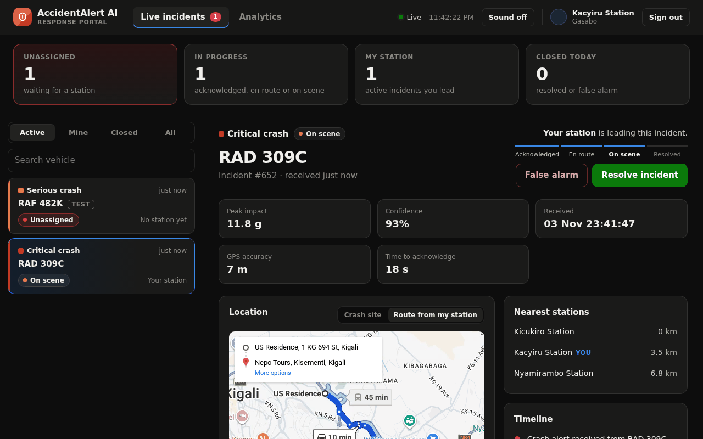
</details>

<details>
<summary><b>Analytics dashboard</b></summary>
<br>
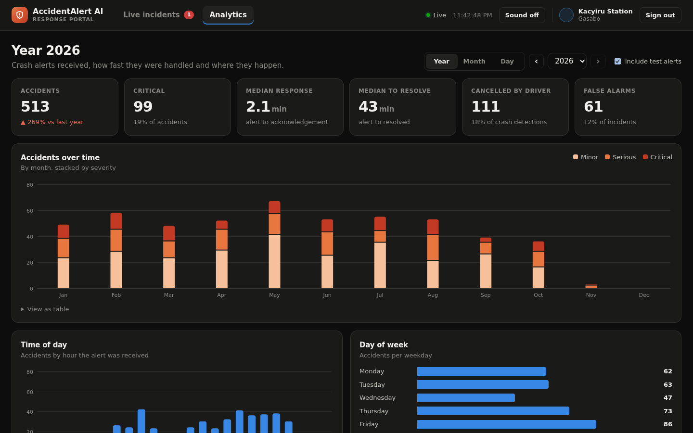
<br><br>
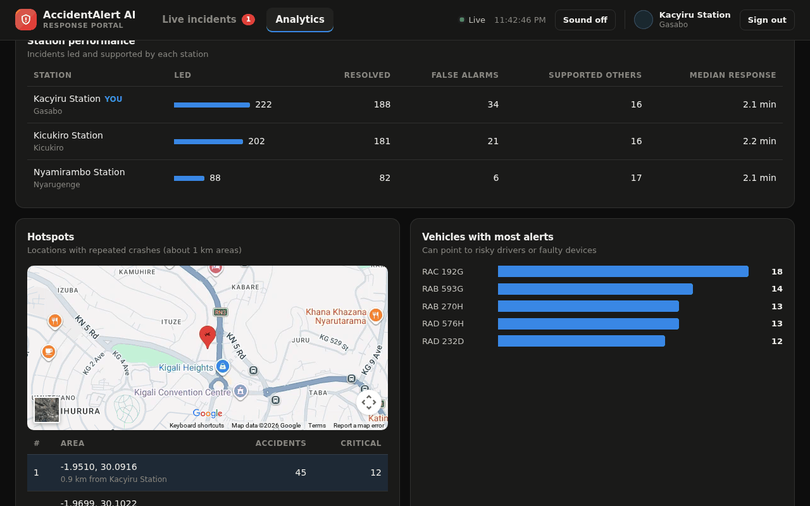
</details>

<details>
<summary><b>Station sign-in and phone app</b></summary>
<br>
<p align="center">
  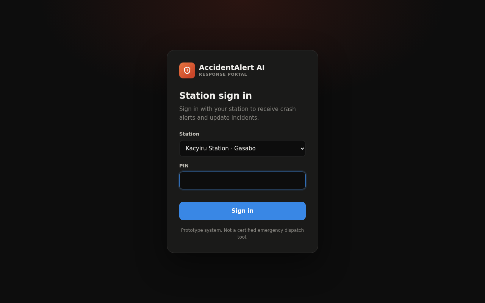
  &nbsp;
  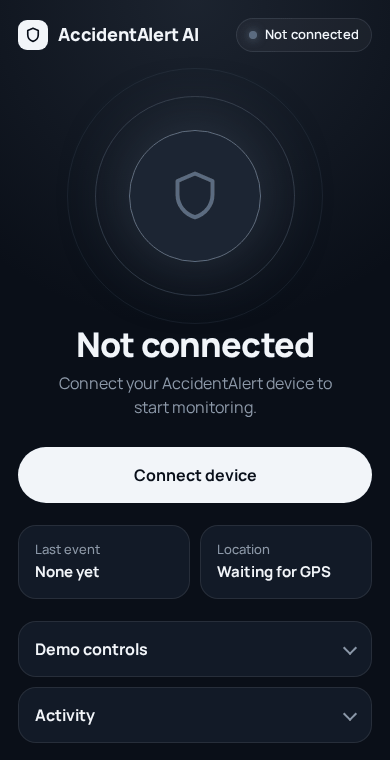
</p>
</details>

<br>

## 🏗️ Architecture

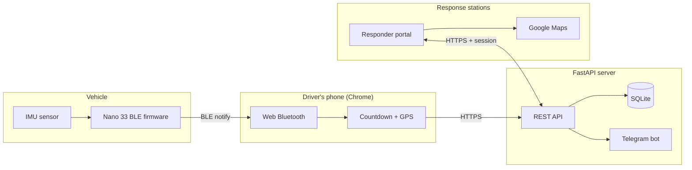

| Layer | Technology |
|---|---|
| Sensor & firmware | Arduino Nano 33 BLE (Rev1 LSM9DS1 / Rev2 BMI270), ArduinoBLE |
| On-device AI | TensorFlow / Keras, exported to plain C arrays (`model_data.h`) |
| Phone app | HTML + JavaScript, Web Bluetooth, Geolocation, Wake Lock, Web Audio |
| Backend | Python, FastAPI, Pydantic, SQLite, httpx |
| Notifications | Telegram Bot API |
| Responder portal | Vanilla JS, hand-built SVG charts, Google Maps embeds |

<br>

## 🧠 The AI model

The `firmware/crash_detector` sketch runs a neural network **on the Nano itself**:

1. A sharp change in acceleration (jerk) opens a **2-second window** of acceleration and rotation, sampled at 100 Hz.
2. **11 features** are computed: peak / min / mean / spread of acceleration, peak jerk, rotation statistics, and *stillness after the impact*.
3. A small dense network (**11 → 16 → 8 → 1**) outputs a crash probability, checked against a threshold tuned for **90% recall** on validation data.

Training data combines the **VZCrash** dataset with our **own recordings** of everyday events that must *not* trigger an alert (bumps, door slams, handling, hard braking) and crash stand-ins (drops, tumbles, cart impacts). Our recordings get extra weight, and every third one is held out for testing.

```bash
python scripts/preprocess.py        # parquet → windows + features
python scripts/evaluate.py          # baseline vs neural network
python scripts/log_events.py COM5 door_slam   # record your own events over serial
python scripts/retrain.py           # retrain with your recordings
python scripts/export_model.py      # write model_data.h for the firmware
```

> [!NOTE]
> The live phone flow currently uses the simpler **threshold firmware** (`firmware/crashguard_firmware`). Connecting the AI firmware to the phone app is on the [roadmap](#-roadmap).

<br>

## 🚀 Quick start

### 1. Run the server

```bash
cd backend
python -m venv .venv && source .venv/bin/activate     # Windows: .venv\Scripts\activate
pip install -r requirements.txt
cp .env.example .env                                  # optional: Telegram, timezone, limits
uvicorn app.main:app --host 0.0.0.0 --port 8000 --env-file .env
```

### 2. Try it with demo data (no hardware needed)

```bash
DB_PATH=./demo.db DEMO_STATION_PIN=2468 python scripts/seed_demo_data.py
DB_PATH=./demo.db DEMO_STATION_PIN=2468 uvicorn app.main:app --port 8000
```

Open **http://localhost:8000/dispatch**, pick a station and enter PIN **2468**. Then open **http://localhost:8000/** and tap **Simulate crash (no device)**.

### 3. Make it HTTPS for the phone

Web Bluetooth, GPS and wake lock only work over HTTPS. For a demo, a free tunnel is enough:

```bash
cloudflared tunnel --url http://localhost:8000       # or: ngrok http 8000
```

Open the `https://…` link on an Android phone in Chrome for the driver app (`/`), and on any computer for the portal (`/dispatch`).

### 4. Flash the sensor

Open `firmware/crashguard_firmware` in the Arduino IDE, set `IMU_REV` (1 or 2) at the top, install **ArduinoBLE** and the matching IMU library, and upload. The Serial monitor (115200) prints the accelerometer range at boot: it should say **16 g** on Rev1 (Rev2 stays at 4 g and flags saturation).

<details>
<summary><b>📋 Phone checklist</b></summary>

Chrome up to date · Bluetooth on · Location on and allowed · Battery saver off · Mobile data on · Screen on · Volume up

</details>

<details>
<summary><b>🏢 Managing stations</b></summary>

```bash
cd backend
python scripts/manage_stations.py add "Kacyiru Station" --area Gasabo --lat -1.9441 --lng 30.0880
python scripts/manage_stations.py list
python scripts/manage_stations.py set-pin 2
python scripts/manage_stations.py remove 2
```

The PIN is asked for interactively, so it never lands in your shell history.

</details>

<details>
<summary><b>💬 Telegram alerts (optional)</b></summary>

1. Create a bot with **@BotFather** and copy its token.
2. Make a group, add the bot, and send a message.
3. Open `https://api.telegram.org/bot<TOKEN>/getUpdates` to find the chat id.
4. Put `TELEGRAM_BOT_TOKEN` and `TELEGRAM_CHAT_ID` in `backend/.env`.

Without them, alerts are still stored and shown in the portal.

</details>

<details>
<summary><b>🔧 Configuration</b></summary>

| Variable | Default | Purpose |
|---|---|---|
| `DB_PATH` | `./crashguard.db` | SQLite database file |
| `TIMEZONE_DISPLAY` | `Africa/Kigali` | Time zone for times and analytics |
| `TELEGRAM_BOT_TOKEN`, `TELEGRAM_CHAT_ID` | empty | Telegram notifications |
| `ALERT_RATE_LIMIT_PER_MIN` | `10` | Alerts per IP per minute |
| `DEMO_STATION_PIN` | empty | Creates 3 demo stations on an empty database |
| `SESSION_HOURS` | `12` | How long a station stays signed in |
| `LOGIN_ATTEMPTS_PER_MIN` | `5` | Sign-in attempts per IP per minute |

</details>

<br>

## 🔌 API reference

| Method | Endpoint | Auth | Purpose |
|---|---|---|---|
| `POST` | `/api/alerts` | rate limited | Phone sends a crash alert |
| `POST` | `/api/events` | rate limited | Phone logs a cancelled or ignored event |
| `GET` | `/api/stations` | public | Station list for sign-in |
| `POST` | `/api/auth/login` · `/logout` | – | Station session |
| `GET` | `/api/alerts?scope=active` | station | Incident list |
| `GET` | `/api/alerts/{id}` | station | Incident with timeline |
| `POST` | `/api/alerts/{id}/updates` | station | Change status, send support, add a note |
| `GET` | `/api/alerts/{id}/nearest-stations` | station | Stations by distance |
| `GET` | `/api/analytics?period=year\|month\|day&date=YYYY-MM-DD` | station | Analytics for a period |

Interactive docs are served at **`/docs`** while the server is running.

<br>

## 📁 Project structure

```text
accident-alert-system/
├── backend/
│   ├── app/
│   │   ├── main.py                 # API, workflow, analytics
│   │   └── static/                 # phone app + responder portal
│   └── scripts/                    # stations, demo data, test alert
├── firmware/
│   ├── crashguard_firmware/        # threshold detector + BLE protocol (used by the phone)
│   └── crash_detector/             # on-device neural network
├── scripts/                        # data prep, training, evaluation, export
├── models/                         # trained models and scalers
├── own_data/                       # our recorded events
└── docs/                           # README images and animations
```

<br>

## 🗺️ Roadmap

- [x] Impact detection firmware with BLE protocol
- [x] Phone app with countdown, GPS and retries
- [x] Responder portal with station workflow and analytics
- [x] Google Maps with route from the station
- [ ] Instant push to the portal (Server-Sent Events) instead of polling
- [ ] Connect the on-device AI model to the phone flow
- [ ] Always-on cloud deployment
- [ ] Field tests in real vehicles
- [ ] Native mobile app that keeps working in the background

<br>

## ⚠️ Disclaimer

This is a **prototype**, not a certified safety device. The crash class is trained on stand-in impacts, not real crashes, and the system has not been tested in real collisions. The phone page must stay open with the screen on. Do not rely on it as your only way to get emergency help.

<details>
<summary><b>Technical notes</b></summary>

- The database column is `event_class` (avoids a SQL keyword); request bodies still use `class`.
- Older databases are migrated on startup: missing incident columns are added, and old `received` alerts become `new` (Unassigned).
- Station PINs are stored as salted PBKDF2 hashes, and session tokens only as SHA-256 hashes.

</details>

<br>

## 🤝 Contributors

<a href="https://github.com/devplusngabo/accident-alert-system/graphs/contributors">
  
</a>

<br>

<div align="center">


**AccidentAlert AI System** · Built to get help there faster.

</div>
